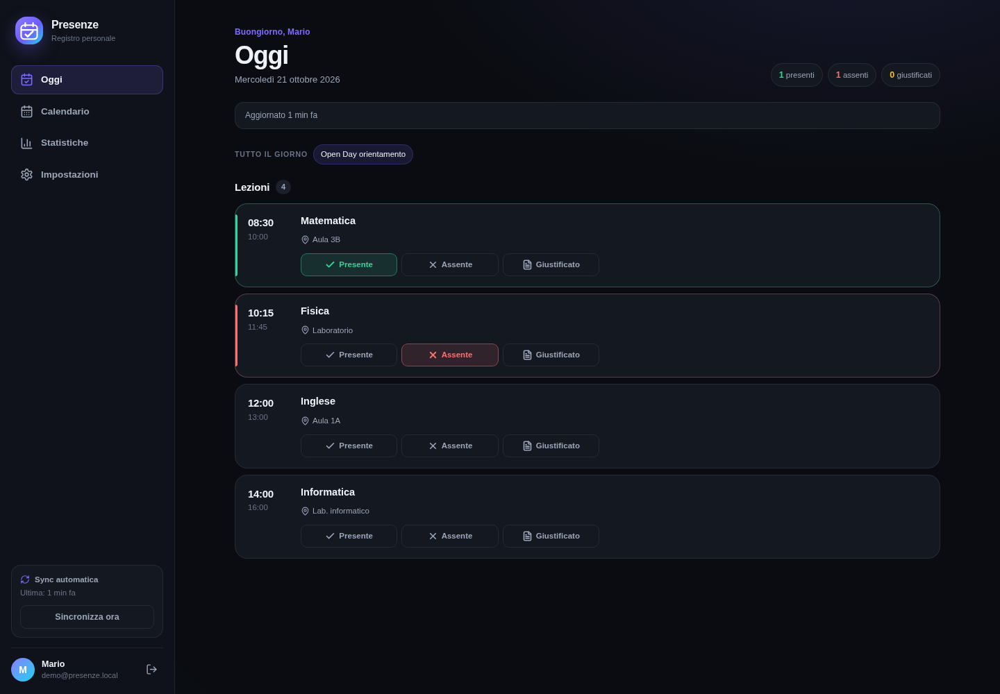
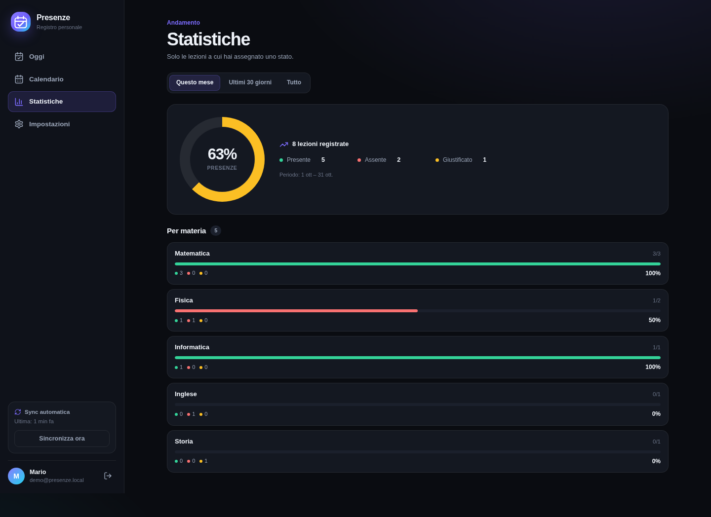
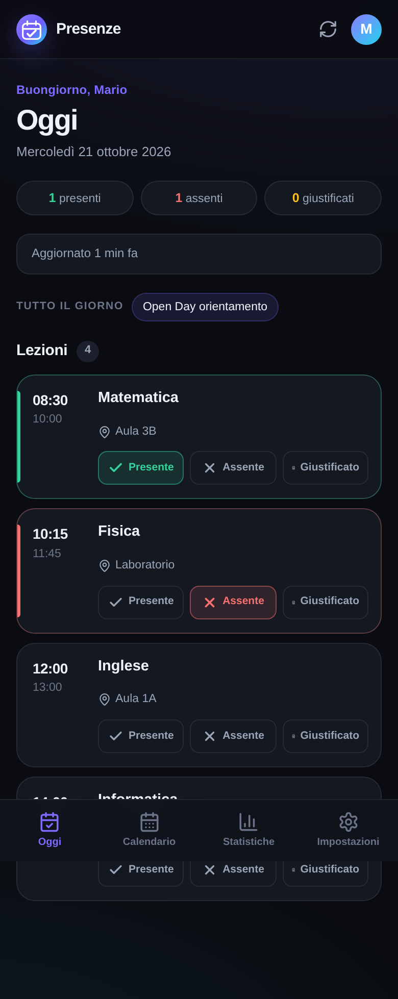

# Presenze

**Registro personale delle presenze per studenti, collegato al tuo Google Calendar.**

Presenze legge gli eventi del calendario (solo in lettura) e li trasforma nelle lezioni da
segnare. Ogni lezione può essere marcata come **presente**, **assente** o **giustificato** con un
tap, da telefono o da computer. Se arrivi in ritardo o esci prima, puoi annotare anche l'orario
effettivo di entrata e di uscita. Le statistiche mostrano le percentuali per materia e periodo.



| Statistiche | Mobile |
| --- | --- |
|  |  |

## Indice

- [Funzioni](#funzioni)
- [Architettura](#architettura)
- [Struttura del progetto](#struttura-del-progetto)
- [Configurare Google Cloud](#configurare-google-cloud)
- [Distribuire a più studenti](#distribuire-a-più-studenti)
- [Sviluppo locale](#sviluppo-locale)
- [Deploy con Docker](#deploy-con-docker)
- [Configurazione](#configurazione)
- [Come funziona la sincronizzazione](#come-funziona-la-sincronizzazione)
- [Statistiche: come vengono calcolate](#statistiche-come-vengono-calcolate)
- [Privacy e sicurezza](#privacy-e-sicurezza)
- [API](#api)
- [Demo e strumenti di sviluppo](#demo-e-strumenti-di-sviluppo)
- [Risoluzione problemi](#risoluzione-problemi)
- [Limiti e roadmap](#limiti-e-roadmap)

## Funzioni

- **Google Calendar in sola lettura**: importa gli eventi del calendario principale o di quelli
  che scegli, senza mai modificarli.
- **Sincronizzazione periodica**: il server riallinea i calendari ogni 15 minuti (configurabile) e
  l'app forza un aggiornamento all'apertura se l'ultima sync è vecchia.
- **Un tap per le presenze**: presente / assente / giustificato. Tocca di nuovo lo stato attivo per
  annullarlo.
- **Entrata e uscita facoltative**: quando arrivi in ritardo o esci prima, puoi indicare l'orario
  effettivo di entrata e di uscita sulla singola lezione. Gli orari restano visibili nella card e
  non modificano il calcolo della percentuale.
- **Vista Oggi**: le lezioni della giornata con orari, aula e stato; azione rapida "segna tutti
  presenti" per le lezioni già iniziate.
- **Calendario mensile**: giorni con puntini colorati per stato, dettaglio del giorno e marking
  direttamente dal pannello.
- **Statistiche**: percentuale complessiva e per materia, con conteggi di presenze, assenze,
  giustificazioni e lezioni ancora da segnare.
- **PWA installabile**: si aggiunge alla home di Android o al desktop e si apre a schermo intero.
- **Account e multi-dispositivo**: accesso con Google, dati sincronizzati sul tuo server.
- **Dati privati**: database sul tuo server, token Google cifrato, nessun servizio di analytics.
- **Privacy e controllo**: pagina `/privacy` pubblica e cancellazione definitiva dell'account con
  rimozione di tutti i dati collegati.

## Architettura

```text
┌─────────────────────────────┐
│  PWA React + TypeScript     │
│  (Android, desktop, browser)│
└─────────────┬───────────────┘
              │  /api (cookie di sessione HttpOnly)
┌─────────────▼───────────────┐        ┌──────────────────────────┐
│  FastAPI                    │  ────► │  Google Calendar API     │
│  - OAuth Google             │        │  (sola lettura)          │
│  - presenze e statistiche   │        └──────────────────────────┘
│  - sync in background       │
└─────────────┬───────────────┘
              │
┌─────────────▼───────────────┐
│  SQLite (volume ./data)     │
└─────────────────────────────┘
```

- **Backend**: Python, FastAPI, SQLAlchemy 2, SQLite. Sessione con JWT in cookie `HttpOnly`; refresh
  token Google cifrato con Fernet. Sync incrementale tramite i `syncToken` di Google Calendar.
- **Frontend**: React 18, Vite, TypeScript, React Router, `vite-plugin-pwa`. CSS custom, tema
  chiaro/scuro automatico.
- **Produzione**: backend e nginx in Docker; con il profilo `production` si aggiunge Caddy per
  HTTPS automatico.

## Struttura del progetto

```text
Presenze/
├── backend/
│   ├── app/
│   │   ├── main.py            # app FastAPI, health check, sync periodica
│   │   ├── config.py          # variabili d'ambiente
│   │   ├── db.py              # engine SQLite e sessioni
│   │   ├── models.py          # User, Event, Attendance, CalendarSync
│   │   ├── schemas.py         # modelli Pydantic
│   │   ├── security.py        # JWT, cifratura token, state OAuth
│   │   ├── google.py          # client Google OAuth + Calendar API
│   │   ├── sync.py            # logica di sincronizzazione
│   │   ├── deps.py            # utente autenticato
│   │   └── routers/           # auth, eventi, account, statistiche
│   ├── scripts/seed_demo.py   # dati demo per provare la UI
│   ├── Dockerfile
│   ├── .env.example           # config per sviluppo locale
│   └── .env.docker.example    # config per Docker
├── frontend/
│   ├── src/
│   │   ├── pages/             # Oggi, Calendario, Statistiche, Impostazioni, Login, Privacy
│   │   ├── components/        # Layout, EventCard, icone, UI
│   │   ├── api.ts  auth.tsx  sync.tsx  toast.tsx
│   │   └── styles.css
│   ├── public/icons/          # icone PWA generate
│   ├── scripts/generate_icons.py
│   └── Dockerfile + nginx.conf
├── data/                      # database SQLite (creato al primo avvio)
├── docs/                      # screenshot
├── Caddyfile                  # reverse proxy HTTPS per il profilo production
├── .env.example               # APP_DOMAIN per Docker Compose
└── docker-compose.yml
```

## Configurare Google Cloud

Serve un progetto Google Cloud con l'API Calendar attiva e un client OAuth **Web application**.
È un passaggio da fare una sola volta.

1. Apri [Google Cloud Console](https://console.cloud.google.com/) e crea (o seleziona) un progetto.
2. **API e servizi → Libreria** → cerca **Google Calendar API** → **Abilita**.
3. Apri **Google Auth Platform**: dal menu ☰ → **API e servizi** → **Google Auth Platform**
   (oppure <https://console.cloud.google.com/auth/overview>). La vecchia voce **Schermata di
   consenso OAuth** è stata rinominata e spostata qui.
   - Se è la prima volta, clicca **Inizia** / **Get started** e compila:
     - **Informazioni app**: nome (es. `Presenze`), email di supporto, email dello sviluppatore;
     - **Pubblico**: **Esterno** (o **Interno** se usi Google Workspace);
     - **Informazioni di contatto**: la tua email.
   - Apri **Pubblico** / **Audience** e aggiungi il tuo indirizzo Gmail tra gli **Utenti di test**.
     Finché l'app è in modalità *Testing* solo questi account possono accedere: per un uso personale
     va benissimo e non serve la verifica Google.
   - Apri **Accesso ai dati** / **Data access** → **Aggiungi o rimuovi ambiti** e aggiungi questi
     quattro scope (puoi cercarli nella lista oppure incollarli in **Aggiungi manualmente gli
     ambiti**):

     | Scope da selezionare | A cosa serve |
     | --- | --- |
     | `openid` | Identificare l'accesso OpenID Connect |
     | `https://www.googleapis.com/auth/userinfo.email` (alias `email`) | Leggere l'indirizzo email |
     | `https://www.googleapis.com/auth/userinfo.profile` (alias `profile`) | Leggere nome e immagine profilo |
     | `https://www.googleapis.com/auth/calendar.readonly` | Leggere calendari ed eventi, **solo in lettura** |

     Per Calendar scegli **`calendar.readonly`**, non `calendar` o `calendar.events`: il primo dà
     accesso in sola lettura a calendari ed eventi, che è tutto ciò che serve all'app. Se nella
     lista non lo trovi, controlla di aver abilitato **Google Calendar API** nel progetto giusto
     (punto 2).
4. Crea il client OAuth: **Google Auth Platform → Client** → **Crea client** →
   **Applicazione web**. (La vecchia voce *Credenziali → Crea credenziali → ID client OAuth* è
   confluita in questa pagina.)
5. In **URI di reindirizzamento autorizzati** inserisci **esattamente** l'URL che userai:

   | Modalità | Redirect URI |
   | --- | --- |
   | Sviluppo Vite (`localhost:5173`) | `http://localhost:8000/api/auth/google/callback` |
   | Docker locale (`localhost:8080`) | `http://localhost:8080/api/auth/google/callback` |
   | Produzione | `https://tuo-dominio.example/api/auth/google/callback` |

   Puoi aggiungerne più di uno: l'importante è che quello configurato in `.env` coincida
   carattere per carattere.
6. Copia **Client ID** e **Client secret** nel file `.env` del backend.

> Lo scope `calendar.readonly` è considerato *sensibile* da Google. Per un uso personale in
> modalità Testing non serve la verifica; se vuoi aprire l'app al pubblico, Google richiede una
> procedura di verifica. In ogni caso l'app non scrive mai sul calendario.

## Distribuire a più studenti

L'app è già multi-utente: ogni persona accede con il **proprio account Google**, ha le proprie
presenze, i propri calendari selezionati e la propria sincronizzazione. Se tutti hanno accesso allo
stesso calendario scolastico, ognuno importerà gli stessi eventi ma le presenze resteranno separate.

Per distribuirlo a una classe servono quattro cose.

### 1. Un indirizzo pubblico HTTPS

Non usare `localhost`: gli altri studenti devono raggiungere un indirizzo stabile, ad esempio
`https://presenze.example.com`. Puoi usare un VPS con Docker e Caddy/nginx, un servizio con volume
persistente o un server della scuola. La PWA e il login Google richiedono HTTPS (tranne che in
locale).

### 2. Configurare il pubblico OAuth

Apri **Google Auth Platform → Pubblico / Audience** e controlla il **tipo utente**:

- **Internal** (consigliato): disponibile se il progetto Google Cloud appartiene alla stessa
  organizzazione Google Workspace della scuola. Solo gli account dell'organizzazione possono
  accedere, senza verifica Google e senza il limite dei 100 utenti di test. Gli account
  `nome.cognome@itsolivetti.it` devono appartenere a quella organizzazione; se il progetto è su un
  altro dominio, chiedi all'IT della scuola di crearlo nell'organizzazione giusta.
- **External**: l'app è aperta a qualsiasi account Google. In modalità **Testing** puoi aggiungere
  al massimo 100 utenti di test, ma i token di accesso scadono dopo **7 giorni**: gli studenti
  dovrebbero ricollegare Google ogni settimana. Per un uso continuativo serve pubblicare l'app e
  completare la verifica Google per lo scope `calendar.readonly`, con privacy policy, homepage e
  video dimostrativo.

Se l'app è **Internal**, non serve la verifica Google. Se l'organizzazione scolastica blocca le app
non approvate, l'amministratore Workspace deve autorizzare il client OAuth o lo scope Calendar.

### 3. Impostare dominio, allowlist e calendario predefinito

Nel `backend/.env` di produzione:

```dotenv
FRONTEND_URL=https://presenze.example.com
GOOGLE_REDIRECT_URI=https://presenze.example.com/api/auth/google/callback
COOKIE_SECURE=true
ALLOWED_EMAIL_DOMAINS=itsolivetti.it,itsolivetti-edu.it
DEFAULT_CALENDAR_IDS=primary,c_288232d4bce5c5fe4098122a24e11e08fedfe7c08688b5be1320eb5b31d2e642@group.calendar.google.com
DATA_CONTROLLER=Nicolò Simonini
PRIVACY_CONTACT_EMAIL=privacy@example.com
```

- `ALLOWED_EMAIL_DOMAINS` accetta tutti gli account di quel dominio. Puoi indicare più domini
  separati da virgola; `ALLOWED_EMAILS` resta disponibile per singole eccezioni. Includi anche il
  dominio del tuo account (nell'esempio `itsolivetti-edu.it`), altrimenti resteresti fuori
  dall'allowlist.
- `DEFAULT_CALENDAR_IDS` viene applicato ai **nuovi utenti**: al primo login il calendario della
  scuola è già selezionato. Gli utenti esistenti possono cambiarlo da **Impostazioni → Calendari**.
- Lo stesso redirect URI deve essere aggiunto in **Google Auth Platform → Client → URI di
  reindirizzamento autorizzati**.

### 4. Condividere il calendario e avviare

Il calendario della scuola deve essere visibile agli account degli studenti (condiviso con il
gruppo o con il dominio). Ogni studente può comunque aprire **Impostazioni → Calendari** e
premere **Sincronizza ora** quando vuole; il server sincronizza anche automaticamente ogni 15
minuti.

Prima di aprire a tutta la classe, prova il flusso con due o tre account. Tieni presente che il
database contiene i dati di tutti: imposta backup periodici e proteggi `SECRET_KEY`. La pagina
`/privacy` è già pubblica; compila `DATA_CONTROLLER` e `PRIVACY_CONTACT_EMAIL` nel `backend/.env`
con i tuoi dati reali. Ogni studente può cancellare autonomamente il proprio account da
**Impostazioni → Eliminazione account**.

## Sviluppo locale

Requisiti: Python 3.11+, Node 20+, un account Google.

### 1. Backend

```bash
cd backend
cp .env.example .env
# Genera una chiave e incollala in SECRET_KEY
python3 -c "import secrets; print(secrets.token_urlsafe(48))"
# Apri .env e inserisci GOOGLE_CLIENT_ID e GOOGLE_CLIENT_SECRET

python3 -m venv .venv
.venv/bin/pip install -r requirements.txt
.venv/bin/uvicorn app.main:app --reload --port 8000
```

Il backend risponde su <http://localhost:8000> e la documentazione interattiva è su
<http://localhost:8000/docs>. Al primo avvio crea automaticamente `backend/data/presenze.db`.

### 2. Frontend

In un altro terminale:

```bash
cd frontend
npm install
npm run dev
```

Apri <http://localhost:5173> e premi **Continua con Google**.

Il server Vite inoltra `/api` a `http://localhost:8000`: il cookie di sessione funziona perché
entrambi sono su `localhost` e il proxy mantiene lo stesso host.

### 3. Verifica rapida

- `GET http://localhost:8000/api/health` → `{"status":"ok","google_configured":true,...}`
- Nelle impostazioni dell'app devono comparire i tuoi calendari Google.
- Se non compaiono eventi, controlla di aver selezionato il calendario giusto e lancia
  **Sincronizza ora**.

## Deploy con Docker

Il `docker-compose.yml` avvia:

- `backend`: FastAPI sulla rete interna, database montato in `./data`;
- `frontend`: nginx su `127.0.0.1:8080`, che serve la PWA e inoltra `/api` al backend;
- `caddy` (opzionale, profilo `production`): reverse proxy con HTTPS automatico sulle porte 80/443.

### 1. Configura l'ambiente

```bash
cp backend/.env.docker.example backend/.env
# Modifica SECRET_KEY, GOOGLE_CLIENT_ID, GOOGLE_CLIENT_SECRET
# Per Docker locale lascia:
#   FRONTEND_URL=http://localhost:8080
#   GOOGLE_REDIRECT_URI=http://localhost:8080/api/auth/google/callback
```

Aggiungi lo stesso redirect URI nella console Google Cloud.

### 2. Avvia in locale

```bash
docker compose up -d --build
```

Apri <http://localhost:8080>. La porta è esposta solo su `127.0.0.1`: per usarla da altri
dispositivi della rete locale servirebbe un reverse proxy o una modifica esplicita al compose.

### 3. Produzione HTTPS con Caddy

Il profilo `production` usa il `Caddyfile` nella root e richiede un dominio che punti già al
server. Crea il file `.env` della root (non quello del backend):

```bash
cp .env.example .env
# Modifica APP_DOMAIN, ad esempio:
# APP_DOMAIN=presenze.example.com
```

Poi imposta in `backend/.env`:

```dotenv
FRONTEND_URL=https://presenze.example.com
GOOGLE_REDIRECT_URI=https://presenze.example.com/api/auth/google/callback
COOKIE_SECURE=true
DATA_CONTROLLER=Il tuo nome o ente
PRIVACY_CONTACT_EMAIL=privacy@example.com
```

Avvia tutto con il profilo:

```bash
docker compose --profile production up -d --build
```

Caddy ottiene e rinnova automaticamente il certificato TLS. Assicurati che:

- il record DNS `A`/`AAAA` di `APP_DOMAIN` punti al server;
- le porte TCP `80` e `443` (e UDP `443` per HTTP/3) siano raggiungibili;
- l'URI `https://presenze.example.com/api/auth/google/callback` sia tra quelli autorizzati in
  Google Cloud;
- `COOKIE_SECURE=true`: con questa impostazione il login non funziona su HTTP.

I certificati e la configurazione di Caddy sono conservati nei volumi `caddy_data` e
`caddy_config`. Se preferisci un reverse proxy esterno, puoi continuare a puntare a
`127.0.0.1:8080` e non attivare il profilo `production`.

### Aggiornamenti

```bash
git pull
# Produzione con Caddy:
docker compose --profile production up -d --build
# Solo locale:
# docker compose up -d --build
```

### Backup

Il database è un singolo file: `./data/presenze.db` (con eventuali `-wal` e `-shm`). Puoi copiarlo
a caldo con:

```bash
sqlite3 data/presenze.db ".backup 'backup-presenze.db'"
```

Per un backup a freddo: `docker compose stop backend`, copia `data/`, poi riavvia.

> Il volume `./data` è l'unico dato persistente: non cancellarlo durante gli aggiornamenti.

## Configurazione

Le variabili del backend si trovano in `backend/.env` (vedi `backend/.env.example` e
`backend/.env.docker.example`). Il dominio di Caddy si imposta invece nel file `.env` della root
(vedi `.env.example`).

| Variabile | Default | Descrizione |
| --- | --- | --- |
| `APP_DOMAIN` (root `.env`) | `localhost` | Dominio pubblico usato dal profilo Caddy, ad esempio `presenze.example.com`. |
| `SECRET_KEY` | *(da cambiare)* | Firma le sessioni e deriva la chiave di cifratura dei token Google. Una chiave lunga e casuale è obbligatoria in produzione. |
| `DATABASE_URL` | `sqlite:///./data/presenze.db` | URL SQLAlchemy. SQLite è sufficiente per uso personale. |
| `FRONTEND_URL` | `http://localhost:5173` | Origine pubblica del frontend, usata nei redirect post-login. Senza slash finale. |
| `COOKIE_SECURE` | `false` | Metti `true` quando servi l'app in HTTPS. |
| `GOOGLE_CLIENT_ID` | — | Client OAuth Google. |
| `GOOGLE_CLIENT_SECRET` | — | Secret del client OAuth. |
| `GOOGLE_REDIRECT_URI` | `http://localhost:8000/api/auth/google/callback` | Deve coincidere con Google Cloud. |
| `ALLOWED_EMAILS` | vuoto | Lista di email separate da virgola autorizzate a usare l'istanza. **Consigliata** se l'app è raggiungibile da Internet. Vuoto = qualsiasi account con accesso al client OAuth. |
| `ALLOWED_EMAIL_DOMAINS` | vuoto | Lista di domini separati da virgola i cui account possono accedere (es. `itsolivetti.it`). Si somma a `ALLOWED_EMAILS`. |
| `DEFAULT_CALENDAR_IDS` | `primary` | Calendari selezionati automaticamente per i nuovi utenti, separati da virgola. |
| `DATA_CONTROLLER` | vuoto | Nome del titolare del trattamento mostrato nella pagina `/privacy`. |
| `PRIVACY_CONTACT_EMAIL` | vuoto | Email di contatto privacy mostrata nella pagina `/privacy`. |
| `SYNC_INTERVAL_MINUTES` | `15` | Intervallo della sincronizzazione automatica lato server. |
| `INITIAL_SYNC_DAYS_BACK` | `180` | Quanti giorni passati importare alla prima sync. |
| `INITIAL_SYNC_DAYS_FORWARD` | `90` | Quanti giorni futuri importare alla prima sync. |
| `SESSION_DAYS` | `30` | Durata della sessione dell'app. |
| `COOKIE_NAME` | `presenze_session` | Nome del cookie di sessione. |

Dopo una modifica a `.env` riavvia il backend (`docker compose restart backend` oppure ferma e
riavvia uvicorn). Cambiare `SECRET_KEY` invalida sessioni e token Google cifrati: bisogna rifare
l'accesso con Google.

## Come funziona la sincronizzazione

1. La prima sync importa gli eventi da `oggi - INITIAL_SYNC_DAYS_BACK` a
   `oggi + INITIAL_SYNC_DAYS_FORWARD` dai calendari selezionati.
2. Google restituisce un `nextSyncToken`: le sync successive sono incrementali e ricevono solo
   creazioni, modifiche e cancellazioni, senza rileggere tutto.
3. Se Google invalida il token (errore `410`), il backend azzera lo stato e rifà una sync completa.
4. Il server controlla ogni minuto quali utenti hanno la sync scaduta e li riallinea in un thread
   separato; l'intervallo è `SYNC_INTERVAL_MINUTES`.
5. All'apertura della PWA, se l'ultima sync ha più di 10 minuti, viene richiesta subito una sync.
6. Gli eventi ricorrenti sono importati come singole occorrenze: ogni lezione ha il proprio stato.
7. Se un evento viene modificato o cancellato su Google, viene aggiornato o rimosso anche in
   Presenze. **Se viene cancellato, l'eventuale presenza associata viene eliminata.**

Gli eventi di tutto il giorno sono visibili nel calendario e nella pagina Oggi, ma non sono
segnabili (non sono lezioni). La percentuale considera solo gli eventi con orario.

## Statistiche: come vengono calcolate

- `rate = presenti / (presenti + assenti + giustificati) × 100`.
- Le lezioni passate **senza stato** compaiono come "da segnare" ma non entrano nella percentuale.
- Le lezioni future sono ignorate.
- Gli orari effettivi di entrata/uscita sono informativi: una lezione con entrata posticipata o
  uscita anticipata resta conteggiata come **presente**.
- Il raggruppamento è per **titolo esatto** dell'evento: se il calendario usa titoli coerenti
  (es. sempre `Matematica`), le statistiche per materia sono accurate. Titoli come
  `Matematica - recupero` creano un gruppo separato.
- "Tutto" parte dal 1° gennaio 2020.

## Privacy e sicurezza

- **Sola lettura**: l'app richiede solo `calendar.readonly` e non crea, modifica o cancella eventi.
- **Token Google cifrato**: il refresh token è cifrato a riposo con Fernet; la chiave deriva da
  `SECRET_KEY`. Il token non viene mai inviato al browser.
- **Sessione**: JWT firmato in cookie `HttpOnly`, `SameSite=Lax`, scadenza 30 giorni. In produzione
  usa HTTPS e `COOKIE_SECURE=true`.
- **OAuth anti-CSRF**: lo `state` OAuth è firmato e legato al browser tramite un cookie `HttpOnly`
  di breve durata, verificato e cancellato nella callback.
- **Isolamento**: ogni query filtra per `user_id`; un utente non può vedere eventi o presenze di un
  altro.
- **Allowlist**: con `ALLOWED_EMAILS` o `ALLOWED_EMAIL_DOMAINS` valorizzate solo quegli account
  possono accedere, anche se il client OAuth è raggiungibile da altri.
- **Pagina privacy pubblica**: `/privacy` è raggiungibile senza login e descrive dati, finalità,
  cookie, conservazione, uso dei dati Google e diritti. Compila `DATA_CONTROLLER` e
  `PRIVACY_CONTACT_EMAIL` prima della distribuzione.
- **Cancellazione self-service**: da **Impostazioni → Eliminazione account** l'utente revoca il
  token Google e cancella profilo, eventi, presenze, calendari e stato di sincronizzazione.
- **Nessun tracker**: niente analytics, font esterni o CDN. Le uniche chiamate esterne sono verso
  Google (OAuth e Calendar API).
- **Database**: SQLite sul tuo server. Proteggi il file con permessi adeguati e includilo nei
  backup.

Nota: in modalità *Testing* Google limita l'accesso agli utenti di test. Se pubblichi l'app con
verifica OAuth, chiunque abbia il link può creare un account: imposta `ALLOWED_EMAILS` o
`ALLOWED_EMAIL_DOMAINS`, oppure proteggi l'istanza a monte (es. basic auth del reverse proxy).

## API

Prefisso `/api`. Autenticazione tramite cookie di sessione.

| Metodo | Percorso | Descrizione |
| --- | --- | --- |
| `GET` | `/health` | Stato del servizio, configurazione Google e contatti privacy. |
| `GET` | `/auth/google/login` | Avvia il flusso OAuth. |
| `GET` | `/auth/google/callback` | Callback OAuth; imposta il cookie e reindirizza alla PWA. |
| `POST` | `/auth/logout` | Cancella il cookie di sessione. |
| `GET` | `/auth/me` | Profilo, calendari selezionati, ultima sync. |
| `GET` | `/events?from=ISO&to=ISO` | Eventi nell'intervallo, con stato di presenza. |
| `PUT` | `/events/{id}/attendance` | Imposta `{"status":"present"\|"absent"\|"excused"}` e, facoltativamente, `entry_time`/`exit_time` in formato `HH:MM` (oppure `null` per cancellarli). |
| `DELETE` | `/events/{id}/attendance` | Annulla lo stato. |
| `GET` | `/stats?from=ISO&to=ISO` | Statistiche complessive e per titolo. |
| `GET` | `/calendars` | Calendari Google disponibili. |
| `PUT` | `/settings` | Imposta `{"calendar_ids":["primary", ...]}`. |
| `POST` | `/sync` | Forza una sincronizzazione e restituisce l'esito. |
| `DELETE` | `/account` | Revoca il token Google, cancella account e dati collegati, rimuove il cookie di sessione. |

La documentazione OpenAPI è disponibile su `http://localhost:8000/docs` quando il backend è
esposto direttamente (in Docker non è pubblicato: passa da nginx solo `/api`).

## Demo e strumenti di sviluppo

### Provare la UI senza Google

Con il backend fermo o attivo (non importa), dalla cartella `backend`:

```bash
.venv/bin/python scripts/seed_demo.py
```

Crea l'utente `demo@presenze.local` con lezioni di esempio e stampa un token di sessione. Per
usarlo nel browser:

1. apri i DevTools → **Application/Applicazione → Cookies → http://localhost:5173**;
2. crea il cookie `presenze_session` con il valore stampato, path `/`;
3. ricarica l'app.

Il token scade dopo 30 giorni. Per rigenerarlo:

```bash
.venv/bin/python -c "
from sqlalchemy import select
from app.db import SessionLocal
from app.models import User
from app.security import create_session_token
db = SessionLocal()
u = db.scalar(select(User).where(User.email == 'demo@presenze.local'))
print(create_session_token(u.id))
"
```

> Questo è solo uno strumento di sviluppo: non crea account reali e non aggira Google OAuth in
> produzione. Non usare dati reali nel database demo.

### Icone PWA

```bash
cd frontend
python3 scripts/generate_icons.py
```

### Build e controllo tipi

```bash
cd frontend
npm run build     # tsc --noEmit + vite build
```

## Risoluzione problemi

| Sintomo | Causa / soluzione |
| --- | --- |
| Login: "Google OAuth non configurato" | Mancano `GOOGLE_CLIENT_ID`/`GOOGLE_CLIENT_SECRET` in `backend/.env`, oppure il backend non è stato riavviato. |
| `redirect_uri_mismatch` | `GOOGLE_REDIRECT_URI` non coincide esattamente con uno degli URI autorizzati in Google Cloud (protocollo, porta, slash). |
| Login ok ma nessun evento | Calendario non selezionato nelle impostazioni, oppure eventi fuori dalla finestra iniziale. Premi **Sincronizza ora**. |
| Un compagno non riesce ad accedere | Se l'app è in modalità Testing, aggiungi la sua email tra gli utenti di test; se è Internal, verifica che il suo account appartenga all'organizzazione Workspace. |
| Il collegamento Google scade ogni 7 giorni | L'app External è in modalità Testing: pubblica l'app e verifica gli scope, oppure configura il pubblico Internal. |
| Banner "Collegamento a Google scaduto" | Token revocato/scaduto o `SECRET_KEY` cambiata: premi **Ricollega Google**. |
| Dopo il login non resta autenticato | In produzione manca HTTPS o `COOKIE_SECURE` è incoerente; in sviluppo il frontend deve passare dal proxy Vite. |
| Statistiche vuote | Non ci sono lezioni passate con stato registrato nel periodo scelto. |
| Orari sfalsati | Il browser usa il fuso locale; il server salva UTC. Controlla il fuso del dispositivo. |
| `database is locked` | Un'altra sync sta scrivendo. Attendi; SQLite è configurato in WAL con timeout 30s. |
| PWA non si installa | Serve HTTPS (o localhost) e un browser compatibile. Su Android: menu → Installa app. |
| Cambio `SECRET_KEY` e perdo tutto | Non perdi i dati, ma tutte le sessioni e i token Google cifrati diventano inutilizzabili: rifai il login. |

## Limiti e roadmap

Limiti attuali:

- migrazioni leggere automatiche per le nuove colonne delle presenze; per modifiche strutturali più
  complesse servirà Alembic;
- un account Google per utente (nessun multi-account);
- offline: la shell PWA è disponibile, ma lettura e scrittura delle presenze richiedono rete;
- statistiche raggruppate per titolo esatto dell'evento;
- nessuna UI per le note (il backend accetta già `note` sullo stato);
- niente notifiche push.

Idee per il futuro:

- note per lezione e giustificazioni con allegati;
- export CSV/PDF delle presenze;
- notifiche per le lezioni non ancora segnate;
- più account Google e più dispositivi con ruoli;
- check-in con orario/GPS;
- modalità insegnante (classi, studenti, registri multipli).

## Licenza

Progetto personale. Nessuna licenza esplicita: se vuoi pubblicarlo, aggiungi la licenza che
preferisci.
